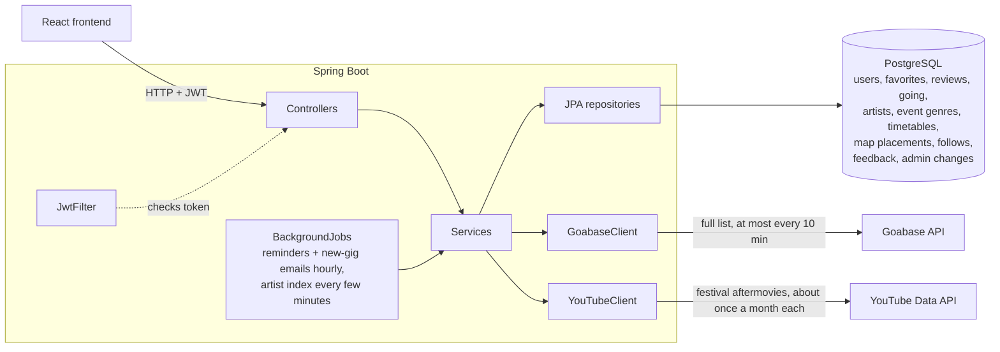

# Map of Psy: backend

[](https://github.com/Peconjii/psytrance-tracker-backend/actions/workflows/ci.yml)

REST API for **Map of Psy**, a galaxy of psytrance genres where every upcoming party sails as a ship to the
stars of the genres it plays. It pulls events from the public [Goabase](https://www.goabase.net) API, reads
their line-ups to work out who plays where and which **map genres** each party has, reads **timetables** from
the line-ups, and lets users register, save events, say they're going, write reviews, **follow artists** and
get emails. Artists, organizers, labels and festivals can own their pages. Admins and editors correct the
data in an **admin panel** with a change history and undo.

**Frontend (React):** [Peconjii/psytrance-tracker](https://github.com/Peconjii/psytrance-tracker)
(screenshots are in its README)

**Live: [psyatlas-one.vercel.app](https://psyatlas-one.vercel.app)** · API:
[psytrance-tracker-backend.onrender.com/api/events](https://psytrance-tracker-backend.onrender.com/api/events)

> Hosted on free tiers (Vercel, Render, Neon). The backend sleeps when nobody uses it, so the first load can take 1–2 minutes.
> An outside cron job pings `GET /api/health` every 14 minutes to keep it awake, so the background jobs keep running.

## Tech stack

- **Java 17**, **Spring Boot 4** — Web MVC, Security, Data JPA, Validation, Mail
- **PostgreSQL** with **Hibernate / JPA** and **Flyway** migrations
- **JWT** authentication (JJWT) with **BCrypt** password hashing
- Spring **RestClient** for the Goabase and YouTube Data API integrations
- **JUnit 5**, **Mockito**, **AssertJ**, **Testcontainers**, **MockMvc**
- **GitHub Actions** CI
- **Maven**
- **Docker** / Docker Compose

## Architecture



Requests go through the usual layers: **controller** (HTTP, validation) → **service** (business logic) →
**repository** (database) or **client** (external API).

### Design decisions

- **Server-side search and paging over a cached snapshot.** Goabase has no paging, only a `limit`.
  `EventService` downloads the full list at most once every 10 minutes, then filters, sorts and pages it
  in memory. This keeps responses fast and avoids hammering Goabase. If a refresh fails, the last good list
  keeps being served instead of an error.
- **One class talks to Goabase.** `GoabaseClient` owns the URLs, timeouts and JSON shape, and maps responses
  into typed records. The rest of the app never sees Goabase's raw format. Redirects are disabled on purpose:
  Goabase answers an unknown event id with a `301` to an HTML page, which the client turns into "not found".
- **Aftermovies without burning the YouTube quota.** A YouTube search costs 100 of the 10,000 free daily
  units, so `AftermovieService` searches at most once a month per festival and stores the result, including
  "nothing found", in PostgreSQL rather than in memory, because the free host restarts the app often. A video
  only counts when its title has the festival's name and "aftermovie"; otherwise the page shows no video
  rather than a wrong one. Without `YOUTUBE_API_KEY` the feature is simply off.
- **Artists picked out of free-text line-ups.** Goabase line-ups are whatever the organizer typed: emoji,
  flags, record labels, stage headers, URLs. `LineUpParser` keeps every line as written and adds the artist
  name only when it's confident (tested against real line-ups), so the frontend can link artists to SoundCloud.
  Genre titles ("Darkpsy/Forest"), credits ("Artwork by ...") and country tags ("[DE]") are left out.
- **An artist index built in the background.** Goabase only has line-ups on its single-event endpoint, so
  "where does this artist play?" would mean hundreds of Goabase calls per request. Instead `ArtistIndexer`
  reads 25 line-ups every few minutes (`APP_ARTISTS_INTERVAL`; events never read first, then the oldest reads,
  since organizers keep adding artists; on a tie the soonest event first) and stores who plays where in PostgreSQL. The same artist written differently ("ACE VENTURA",
  "Ace Ventura") is matched by a slug (`ace-ventura`) that also serves as the page address, and the normal
  spelling is preferred over all-caps.
- **Reminder emails that are safe to run any time.** `ReminderService` runs every hour and emails users about
  events they saved or are going to that start in the next 3 days, one email per user listing all of them.
  Every sent reminder is recorded (unique per user and event), and only after a successful send, so nobody
  gets one twice, a failed email is retried, and runs missed while the free server was asleep are caught up.
  Users can turn reminders off on their profile.
- **"I'm going" counts without N+1 queries.** The events page asks for a whole page of counts at once
  (`GET /api/events/going?ids=...`), answered with one `GROUP BY` query plus one query for the user's own
  marks. Marking twice is harmless: the insert uses PostgreSQL's `ON CONFLICT DO NOTHING` against a unique
  constraint, so even two clicks at the same moment can't create a duplicate.
- **Map genres from the line-up.** `EventGenres` gives each party its Map of Psy genres from the best evidence
  it has: artists placed on the map count most, then genres named in stage headers ("DARKPSY / FOREST STAGE"),
  and only when the line-up says nothing the genres the organizer ticked on Goabase (read from its JSON-LD,
  ignored when more than 4 are ticked). Every artist counts once, split between their genres, so the shares say
  where the party's ship sits between the stars. Genres an admin set by hand (`MANUAL`) are never overwritten.
- **Timetables from free text.** `TimetableParser` reads set times written in line-ups ("22:00 - 00:00 | Naraka",
  "7:00 PM – 8:00 PM", sets after midnight, stage headers, date lines), on the venue's clock with its UTC offset.
  Each set gets a map genre (its artist, a genre written next to it, or its stage) for the live fleets.
- **Map placements in the database.** Which artist orbits which genre started as `genres.json` and now lives in
  `map_artist_genres` (seeded from the JSON on first start), so admins can change it and it applies at once:
  to the map, and to the genres of that artist's events, whose line-ups are marked to be read again.
- **Admin panel without roles in the database.** Admins are the usernames in `ADMIN_USERNAMES`, compared exactly.
  `/api/admin/**` is closed in `SecurityConfig` and every endpoint checks again; a test finds every admin
  endpoint and checks that guests get 401 and users 403. Every change is logged in `admin_changes` (who,
  before, after) and can be undone as a new change, refused when the same thing was changed again since.
- **Following artists.** Follows and the gigs a follower already knows about are stored, so the hourly job
  emails only gigs that are new, each once, and the gigs known when following starts are not mailed.
- **Abuse limits.** 10 wrong passwords for one username lock it for 15 minutes; one address gets at most 3
  password reset emails an hour; the feedback form takes 5 messages an hour per address and quietly drops
  bots that fill a hidden field. Feedback page links must be pages of this site.
- **Testable time.** Date logic ("upcoming", "this weekend") uses an injected `java.time.Clock`, so tests can
  pin "today" to a fixed date and move time forward to test cache expiry.
- **Stateless auth.** Login returns a signed JWT; every protected request is authenticated from its
  `Authorization: Bearer` header. Users can only read and change their own favorites.
- **Password reset without leaking accounts.** Reset links carry a random 256-bit token; only its SHA-256
  hash is stored, it expires after 30 minutes and works once. The endpoint answers identically for known and
  unknown emails, so it can't be used to discover who has an account.
- **Schema changes as versioned SQL.** Flyway migrations in `src/main/resources/db/migration` own the database
  schema, and Hibernate only validates that the entities match it (`ddl-auto=validate`). Every database (local,
  Docker, tests, production) goes through the same numbered steps, which are reviewed in git like any other code.
  Moving off `ddl-auto=update` also surfaced a real gap: it had never added the unique constraint on usernames
  to the existing table, which `V2__unique_username.sql` now does.
- **Consistent errors.** A `@RestControllerAdvice` turns validation failures, conflicts, missing events and
  Goabase outages into JSON responses with the right status code (`400`, `404`, `409`, `503`).

## API

| Method | Endpoint | Auth | Description |
|---|---|---|---|
| `POST` | `/api/auth/register` | – | Create an account (`username`, `email`, `password`) |
| `POST` | `/api/auth/login` | – | Returns `{ "token": "..." }` |
| `GET` | `/api/auth/me` | ✔ | Current user |
| `POST` | `/api/auth/forgot-password` | – | Email a one-time reset link (`email`); same answer whether or not the account exists |
| `POST` | `/api/auth/reset-password` | – | Set a new password with the link's token (`token`, `newPassword`) |
| `GET` | `/api/events` | – | Paged, filtered event list (see below) |
| `GET` | `/api/events/map` | – | All events that have coordinates, for the map |
| `GET` | `/api/events/{id}` | – | One event |
| `GET` | `/api/events/{id}/aftermovie` | – | The festival's aftermovie on YouTube (`videoId`, `title`), or `204` if there is none |
| `GET` | `/api/events/{id}/details` | – | One event with times, line-up (each artist with the `artistSlug` of their page), venue notes, entry fee, description and organizer (cached per event) |
| `GET` | `/api/events/going?ids=1,2,3` | – | `{ "1": { "count": 4, "going": true }, ... }` for up to 100 events; `going` is always `false` for guests |
| `GET` | `/api/events/{id}/going` | – | `{ "count", "going" }` for one event |
| `PUT` | `/api/events/{id}/going` | ✔ | Mark yourself as going (doing it twice changes nothing) |
| `DELETE` | `/api/events/{id}/going` | ✔ | Not going any more |
| `GET` | `/api/me/going` | ✔ | Events you're going to (`eventId`, `eventName`, `startsOn`), soonest first |
| `PUT` | `/api/me/reminders` | ✔ | Turn reminder emails on or off (`enabled`) |
| `GET` | `/api/artists?search=` | – | Artists playing upcoming events (`slug`, `name`, `upcomingEvents`), busiest first; search ignores case and accents |
| `GET` | `/api/artists/{slug}` | – | One artist and their upcoming events, soonest first |
| `GET` | `/api/events/{id}/timetable` | – | Set times read from the line-up or set by an admin (`stage`, `artist`, `startsAt`, `endsAt`, `genreId`) |
| `GET` | `/api/map/events?period=` | – | The events of the next `WEEK` or `MONTH` with their map genres (`genreId`, `share`, `source`) |
| `GET` | `/api/map/genres?ids=1,2,3` | – | Map genres of up to 100 events, for the event tickets |
| `GET` | `/api/map/timetables?period=` | – | The period's timetables, for the live fleets |
| `GET` | `/api/map/placements` | – | Which artists orbit which genre: `{ genreId: [names] }` |
| `GET` | `/api/me/follows` | ✔ | Artists you follow |
| `PUT` / `DELETE` | `/api/me/follows/{slug}` | ✔ | Follow / unfollow an artist |
| `GET` | `/api/me/follows/gigs` | ✔ | Upcoming events where artists you follow play |
| `POST` | `/api/feedback` | – | Send feedback (`kind`, `aboutType`, `aboutRef`, `pageUrl`, `message`, `email`) |
| `GET` | `/api/health` | – | `{ "status": "ok" }` without touching the database, for a keep-awake ping |
| `GET` / `PATCH` | `/api/admin/feedback[/{id}]` | admin | Feedback inbox; change a message's status |
| `GET` | `/api/admin/artists?search=` | admin | Map and line-up artists with their map genres |
| `PUT` | `/api/admin/artists/genres` | admin | Place an artist in exactly these genres (`name`, `genres`) |
| `POST` | `/api/admin/artists/hidden`, `/merge` | admin | Hide a word that isn't an artist; merge two spellings of one artist |
| `GET` / `PUT` | `/api/admin/events/{id}/genres` | admin | An event's genres; set them by hand (`[]` hands back to the line-up) |
| `PUT` / `DELETE` | `/api/admin/events/{id}/timetable` | admin | Set a timetable by hand; back to the line-up |
| `GET` | `/api/admin/changes` | admin | Change history, newest first |
| `POST` | `/api/admin/changes/{id}/undo` | admin | Undo a change |
| `GET` | `/api/favorites/{userId}` | ✔ own | User's favorites |
| `POST` | `/api/favorites/{userId}` | ✔ own | Add favorite (`eventId`, `eventName`) |
| `DELETE` | `/api/favorites/{userId}?eventId=` | ✔ own | Remove favorite |
| `POST` | `/api/reviews` | ✔ | Add or update your review of an event (`eventId`, `rating` 1–5, `comment`) |
| `GET` | `/api/reviews/event/{eventId}` | – | Reviews of an event |
| `GET` | `/api/reviews/user` | ✔ | Your reviews |

### `GET /api/events`

| Parameter | Default | Description |
|---|---|---|
| `page` | `0` | Page number, starting at 0 |
| `size` | `24` | Page size, 1–100 |
| `search` | – | Matches event name or town |
| `country` | – | Matches country name |
| `genre` | – | Matches event type or name, e.g. `Forest` |
| `timeline` | `ALL` | `ALL` or `THIS_WEEKEND` |

```http
GET /api/events?page=0&size=2&country=spain&timeline=THIS_WEEKEND
```

```json
{
  "content": [
    {
      "id": 115531,
      "nameParty": "Transition Experience 2026 - OA Psytrance Festival",
      "nameTown": "Almonte",
      "nameCountry": "Spain",
      "nameType": "Open Air",
      "nameStatus": "Scheduled",
      "dateStart": "2026-09-22",
      "dateEnd": "2026-09-28",
      "urlImageMedium": "https://img.goabase.net/...",
      "urlPartyHtml": "https://www.goabase.net/party/...",
      "lat": 37.3,
      "lon": -6.5
    }
  ],
  "page": 0,
  "size": 2,
  "totalElements": 7,
  "totalPages": 4,
  "hasNext": true
}
```

## Quick start with Docker

The fastest way to run everything (database, backend and frontend) is Docker Compose. Clone both repos next
to each other:

```bash
git clone https://github.com/Peconjii/psytrance-tracker-backend.git
git clone https://github.com/Peconjii/psytrance-tracker.git

cd psytrance-tracker-backend
docker compose up --build
```

Then open **http://localhost:5173**. The API is on `http://localhost:8080`, and the data lives in a Docker
volume, so it survives restarts (`docker compose down -v` wipes it).

The database password and JWT secret in `docker-compose.yml` are throwaway values for this local setup.

## Running locally without Docker

**You need:** JDK 17+ and a PostgreSQL database (local, or hosted such as Supabase).

The app reads its configuration from environment variables. Nothing secret is stored in the repository.

| Variable | Example |
|---|---|
| `DB_URL` | `jdbc:postgresql://localhost:5432/psytrance` |
| `DB_USERNAME` | `postgres` |
| `DB_PASSWORD` | your database password |
| `JWT_SECRET` | at least 32 characters, e.g. from `openssl rand -base64 48` |

```bash
export DB_URL=jdbc:postgresql://localhost:5432/psytrance
export DB_USERNAME=postgres
export DB_PASSWORD=secret
export JWT_SECRET=$(openssl rand -base64 48)

./mvnw spring-boot:run
```

In IntelliJ, set the same variables under *Run → Edit Configurations → Environment variables*.

**Email (optional).** Password reset and reminder emails are sent over SMTP when these are set:

| Variable | Example (Gmail) |
|---|---|
| `SPRING_MAIL_HOST` | `smtp.gmail.com` |
| `SPRING_MAIL_PORT` | `587` |
| `SPRING_MAIL_USERNAME` | `you@gmail.com` |
| `SPRING_MAIL_PASSWORD` | a Gmail [app password](https://myaccount.google.com/apppasswords), not your normal password |
| `MAIL_FROM` | `you@gmail.com` |
| `FRONTEND_URL` | `http://localhost:5173` (default), used to build the reset link and allowed by CORS |

**Other settings**

| Variable | What it does |
|---|---|
| `ADMIN_USERNAMES` | Comma-separated usernames that may use the admin panel, compared exactly (`admin,psyatlas`) |
| `APP_ARTISTS_INTERVAL` | How often the artist index reads a batch of 25 line-ups (default `PT3M`; `PT30M` saves free database hours) |

Without `SPRING_MAIL_HOST`, the emails (reset links, reminders) are written to the application log instead,
which is enough for local development.

**YouTube aftermovies (optional).** Set `YOUTUBE_API_KEY` to a YouTube Data API v3 key (Google Cloud Console →
*APIs & Services* → enable *YouTube Data API v3* → *Credentials* → *Create API key*). Without it, festival
pages just have no aftermovie.

The API starts on `http://localhost:8080`. On first start, Flyway creates the tables from the SQL migrations.
CORS allows the frontend dev server at `http://localhost:5173` and the address in `FRONTEND_URL`.
If the `PORT` variable is set (as on Render), the API listens on that port instead.

## Tests

```bash
./mvnw test
```

Docker must be running: the integration tests start a throwaway PostgreSQL container with
[Testcontainers](https://testcontainers.com). No other setup or environment variables are needed.
GitHub Actions runs the same tests on every push.

**Unit tests** check one class on its own. Its dependencies are mocked, and time is controlled with a fake `Clock`.

- `EventServiceTest`: paging, sorting, search, timeline filters and the cache (one fetch while fresh, refresh
  after expiry, old list kept when Goabase is down)
- `PasswordResetServiceTest`: unknown emails send nothing, only the token hash is stored, a link works once,
  expired or made-up links are rejected
- `ReminderServiceTest`: only events starting in the next 3 days, saved and going events in one email, nothing
  sent twice, failed emails retried, reminders that were turned off stay off
- `ArtistIndexerTest`: events never read come first, then the oldest reads, soonest event first on a tie; at
  most one batch per run; stops when Goabase is down; map genres stored with the line-up
- `EventGenresTest`, `MapGenresTest`: genres from map artists, stage headers and keywords; merged spellings
- `TimetableParserTest`: set times in many styles, after midnight, stages and dates, HTML entities, "Live" acts
- `LineUpParserTest`, `ArtistNamesTest`: artist names from real line-ups; spellings of one artist share a slug

**Integration tests** start the whole application with real security and a real PostgreSQL, and call the API
through MockMvc. Only Goabase is faked.

- `AuthIntegrationTest`: register, log in, `/me`; passwords stored as BCrypt hashes and never returned;
  duplicate usernames, validation errors, wrong passwords, missing or invalid tokens
- `FavoriteIntegrationTest`: add, list, remove; duplicates are a `409`; **users can't read or change someone
  else's favorites** (`403`)
- `ReviewIntegrationTest`: reading is public, writing needs login, a second review updates the first,
  rating must be 1–5
- `EventApiIntegrationTest`: paging, filters, invalid parameters, unknown events, Goabase outages
- `GoingIntegrationTest`: guests see counts but must log in to mark, marking twice counts once, a page of
  counts in one request, unknown events are a `404`
- `ReminderIntegrationTest`: one reminder per user and event even across runs, users can turn reminders off
- `ArtistIntegrationTest`: indexing line-ups, artist pages, busiest-first list, accent-free search, a re-read
  line-up replaces the old one
- `MapIntegrationTest`, `TimetableIntegrationTest`: map events with genres, placements, timetables
- `AdminAccessIntegrationTest`: every admin endpoint, found automatically, is closed to guests (401) and users (403)
- `AdminArtistIntegrationTest`, `AdminEventIntegrationTest`, `AdminChangeIntegrationTest`,
  `ArtistCleanupIntegrationTest`: the admin panel, its history and undo
- `FeedbackIntegrationTest`: guests can send, only admins read, rate limit, hidden bot field, links to this site only
- `FollowIntegrationTest`: follow and unfollow, the gigs for the map, only new gigs emailed, each once

## Roadmap

- [x] Docker Compose setup (PostgreSQL + backend + frontend)
- [x] Integration tests with Testcontainers
- [x] GitHub Actions CI
- [x] Flyway migrations instead of `ddl-auto=update`
- [x] Live deployment: backend on Render (Docker), database on Neon (PostgreSQL), frontend on Vercel
- [x] "I'm going" with attendance counts
- [x] Reminder emails before saved events (scheduled job)
- [x] Artist pages built from event line-ups
- [x] Map of Psy as the home page: map genres, timetables and live fleets
- [x] Feedback form and admin panel with history and undo
- [x] Following artists with new-gig emails
- [x] Event filters by map genre instead of words in the event name
- [x] Email confirmation, and events added on the site (approved by an admin) next to Goabase's
- [x] Label and festival pages, numbers for artists, labels and festivals (owners see more)
- [x] Page owners: "Claim this page" (email domain or an admin), "Not on the map yet?" requests
- [x] Roles from the admin panel: admins and editors (content only)
- [x] Stage cards in the event form, read like any line-up (a stage's genre in brackets)
- [ ] Deployment to AWS

## Credits

Event data from [Goabase](https://www.goabase.net).
